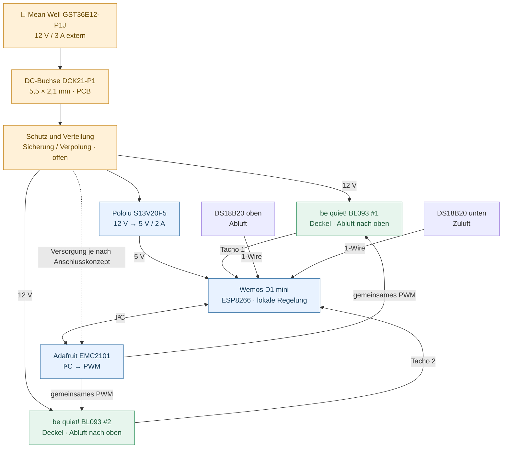
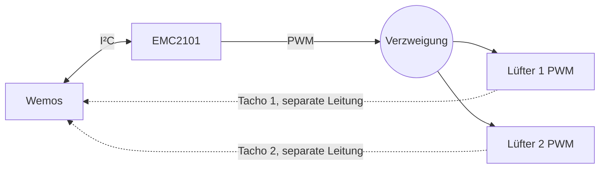
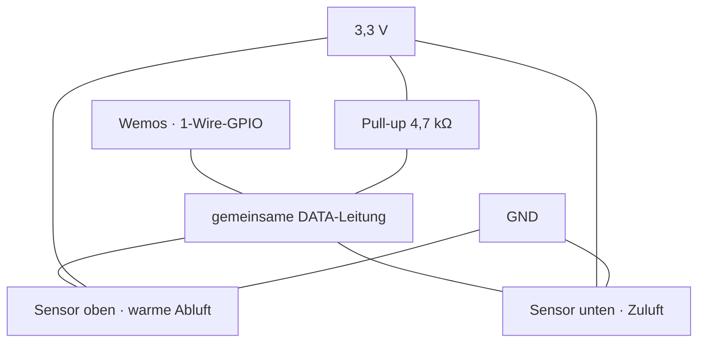
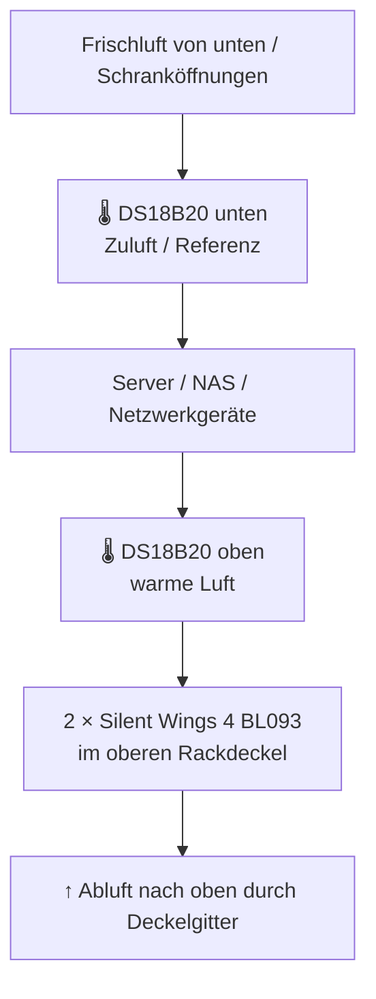

# VENTIQ — Hardware

> **Smart Cooling System · VENTIQ Core RevA**  
> **Stand:** 23. Oktober 2026 · **Phase:** Hardwarekonzept / Komponentenauswahl  
> **Status:** Hauptkomponenten ausgewählt; elektrische und mechanische Freigabe teilweise offen  
> **Bezugsquellen:** [BerryBase](https://www.berrybase.de/) · [Amazon.de](https://www.amazon.de/)

---

## 1. Projekt auf einen Blick

**VENTIQ** ist ein lokal arbeitender, temperaturgeregelter Lüftercontroller für einen 19-Zoll-Netzwerkschrank. Er soll effizient und geräuscharm warme Luft aus dem Rackdeckel abführen, die Temperaturen **oben und unten** messen und die Drehzahl **jedes Lüfters unabhängig** überwachen. Die spätere WLAN-/ioBroker-Anbindung darf für die eigentliche Kühlfunktion nicht erforderlich sein.

| 🗄️ Einsatz | 🌬️ Kühlung | 🌡️ Sensorik | 🧠 Steuerung |
|:--|:--|:--|:--|
| kab24 SOHO, 20 HE, 600 × 450 mm Grundfläche | 2 × 120-mm-Lüfter **im oberen Deckel**, Abluft nach oben | 2 × DS18B20, einer oben und einer unten | Wemos D1 mini + Adafruit EMC2101 |

### Zielarchitektur



> **Wichtig:** Diese Grafik zeigt Funktionen, **keinen geprüften Schaltplan**. Pinbelegung, Schutzbeschaltung, EMC2101-Versorgung und PWM-Fail-safe werden vor der Platinenfreigabe festgelegt.

---

## 2. Auswahlstatus und vollständige Haupt-Stückliste

**Legende:** ✅ entschieden · 🧪 entschieden, aber technisch zu prüfen · 📐 mechanisch zu prüfen · 🛒 Angebot / Bestand vor Bestellung prüfen.

| Bereich | Artikel / genaue Ausführung | Menge | Bezugsquelle | Status |
|---|---|---:|---|---|
| Controller | **Wemos D1 mini (ESP8266)** | 1 | Bereits vorhanden | ✅ |
| PWM-Modul | **Adafruit EMC2101**, ADA4808 | 1 | [BerryBase](https://www.berrybase.de/adafruit-emc2101-i2c-pc-luefter-controller-und-temperatursensor) | 🧪 |
| Lüfter | **be quiet! Silent Wings 4, 120 mm PWM, BL093, schwarz** | 2 | [Amazon-Suche](https://www.amazon.de/s?k=be+quiet+Silent+Wings+4+BL093) · [Hersteller](https://bequiet.com/de/casefans/3700) | ✅ 📐 |
| DC/DC | **Pololu S13V20F5**, 5 V / 2 A, POL4085 | 1 | [BerryBase](https://www.berrybase.de/pololu-s13v20f5-5v-2a-step-up-step-down-spannungsregler) | ✅ |
| Externes Netzteil | **Mean Well GST36E12-P1J**, 12 V / 3 A / 36 W | 1 | [BerryBase](https://www.berrybase.de/meanwell-schaltnetzteil-12v-dc-3-0a-mit-hohlstecker-5-5x2-1mm) | ✅ |
| Temperatursensoren | **DS18B20, wasserdichte 3-adrige Fühler mit 1 m Kabel**, 5er-Set | 1 Set (2 genutzt) | [Amazon, ASIN B0GLXCGXCW](https://www.amazon.de/dp/B0GLXCGXCW) | ✅ 🧪 |
| PCB-Strombuchse | **DCK21-P1**, DC-Hohlbuchse 5,5 × 2,1 mm, 90° THT | 1 | [BerryBase](https://www.berrybase.de/dc-kupplung-fuer-hohlstecker-5-5x2-1mm-printmontage-loetoesen) | ✅ 🧪 |

### Preisnotizen (keine verbindlichen Warenkorbpreise)

| Artikel | Letzter recherchierter BerryBase-Einzelpreis |
|---|---:|
| Adafruit EMC2101 | 5,80 € |
| Pololu S13V20F5 | 17,95 € |
| Mean Well GST36E12-P1J | 17,10 € |
| DCK21-P1 | 0,35 € |
| **Summe dieser vier Positionen** | **41,20 €** |

**Noch nicht eingerechnet:** 2 Lüfter, Amazon-DS18B20-Set, Porto, PCB, Steckverbinder, Widerstände, Absicherung, Gehäuse und Montagematerial. Preise und Verfügbarkeit sind Momentaufnahmen und können abweichen. **Einkaufsregel:** identische Teile bei Amazon.de und BerryBase vergleichen und die günstigere *Gesamtbestellung einschließlich Versand* wählen. Spezialmodule nur bei gleicher technischer Ausführung ersetzen.

---

## 3. Bauteilkarten

### 🧠 01 — Wemos D1 mini · Mikrocontroller

| Rolle | Ausgangslage | Funktion |
|---|---|---|
| Zentrale lokale Steuerung | **Bereits vorhanden** | I²C, 1-Wire, zwei separate Tacho-Eingänge, WLAN / spätere ioBroker-Anbindung |

```text
  ┌────────────────────────┐
  │      WEMOS D1 MINI     │
  │        ESP8266         │
  │                        │
  │  I²C  → EMC2101        │
  │  1-Wire → Sensoren × 2 │
  │  GPIO ← Tacho 1 / 2    │
  │  5 V ← Pololu          │
  └────────────────────────┘
```

- Der Wemos läuft mit **3,3-V-GPIO-Logik**, obwohl seine Platine über den passenden 5-V-Eingang versorgt wird.
- Kein ESP32 geplant.
- Tachosignale dürfen **nicht miteinander verbunden** werden.

**Vorläufige Pins:** D1/GPIO5 = SCL, D2/GPIO4 = SDA, D5/GPIO14 = Tacho 1, D6/GPIO12 = Tacho 2. Der 1-Wire-GPIO ist noch festzulegen; ESP8266-Boot-Pins und Pin-Konflikte müssen geprüft werden.

### 🎛️ 02 — Adafruit EMC2101 · gemeinsamer PWM-Controller

**[Bei BerryBase ansehen →](https://www.berrybase.de/adafruit-emc2101-i2c-pc-luefter-controller-und-temperatursensor)** · **[Adafruit-Hardwareprojekt →](https://github.com/adafruit/Adafruit-EMC2101-PCB)** · **[Pinout / Dokumentation →](https://learn.adafruit.com/emc2101-fan-controller-and-temperature-sensor/pinouts)**

| Merkmal | Festlegung |
|---|---|
| Produkt | Adafruit ADA4808, Breakout mit EMC2101 |
| Schnittstelle | I²C zum Wemos |
| Aufgabe | **Ein gemeinsames PWM-Steuersignal** für beide Lüfter |
| Tacho-Auswertung | **Nicht** über den EMC2101; zwei GPIOs am Wemos |
| Status | Ausgewählt; konkreter Betriebsmodus **noch nicht validiert** |



**Vor PCB-Freigabe prüfen:** manuelle PWM-Vorgabe ohne Tacho am EMC2101; richtige PWM-Frequenz und Ausgangspegel; Open-Drain-/Pull-up-Beschaltung; Eignung für zwei parallel angeschlossene PWM-Eingänge; Verhalten bei Reset, I²C-Ausfall und ungeplanter Spannungslosigkeit. Das Adafruit-Breakout hat laut Dokumentation einen bereits vorhandenen Pull-up am FAN-Ausgang; **nicht blind einen weiteren oder einen 12-V-Pull-up hinzufügen**.

### 🌬️ 03 — be quiet! Silent Wings 4 PWM · 2 × BL093

**[Herstellerseite + Datenblatt →](https://bequiet.com/de/casefans/3700)** · **[Amazon-Angebote →](https://www.amazon.de/s?k=be+quiet+Silent+Wings+4+BL093)**

| Technische Eigenschaft | Je Lüfter |
|---|---:|
| Artikelnummer | **BL093** (nicht BL094 High-Speed) |
| Farbe | **Schwarz** |
| Größe | **120 × 120 × 25 mm** |
| Spannungsversorgung | 12 V DC |
| Anschluss | **4-Pin-PWM** |
| Max. Drehzahl | 1.600 U/min |
| Max. Luftförderung | 82,7 m³/h |
| Max. statischer Druck | 1,79 mmH₂O |
| Hersteller-Geräuschwert | 18,9 dB(A) bei Höchstdrehzahl |
| Maximale Stromaufnahme | 0,12 A pro Lüfter (Herstellerangabe) |

**Montagekonzept**

```text
  RAUM / AUSSEN
          ↑ warme Luft     ↑ warme Luft
  ────────┬────────────────┬──────────  Rackdeckel / Gitter
       ┌──┴───┐         ┌──┴───┐
       │ BL093│         │ BL093│       120 mm, schwarz
       └──────┘         └──────┘
     Lüfter 1          Lüfter 2
            INNERES RACK
```

- Beide Lüfter sitzen **oben im Rackdeckel** und blasen **nach oben nach außen**.
- Gemeinsamer PWM-Sollwert, aber **zwei getrennte Tacho-Leitungen** zur Fehlererkennung.
- Antivibrationsmontage vorsehen, um Körperschall am Blechdeckel zu begrenzen.
- **Mechanische Freigabe fehlt:** Öffnungsgröße, seitliche Befestigungsabstände, Deckeldicke, Abstand zum Gitter, freie Einbauhöhe und Steckerführung ausmessen. Das Foto alleine beweist keine 120-mm-Montagekompatibilität.

### ⚡ 04 — Pololu S13V20F5 · 5-V-Versorgungsmodul

**[Bei BerryBase ansehen →](https://www.berrybase.de/pololu-s13v20f5-5v-2a-step-up-step-down-spannungsregler)**

| Merkmal | Wert |
|---|---|
| Modell | **S13V20F5**, BerryBase POL4085 |
| Wandlertyp | Step-up / Step-down |
| Eingang | 12-V-Versorgung (zulässigen Bereich im Datenblatt beachten) |
| Ausgang | **5 V / bis zu 2 A** |
| Aufgabe | 5-V-Schiene für Wemos; weitere 5-V-Verbraucher nur nach Strombilanz |
| Montage | Fertiges Modul, auf PCB steckbar vorgesehen |

```text
     12 V DC ──► [ POLOLU S13V20F5 ] ──► 5 V ──► Wemos D1 mini
                       │
                 GND gemeinsam
```

Der **S13V20F5 ersetzt** den früher geplanten D24V10F5 und die zwischenzeitlich diskutierten nicht lieferbaren Alternativen. Die Lüfter beziehen weiterhin direkt **12 V**, **nicht** 5 V. Modul-Pinbelegung, Footprint und Stromreserve sind für die Trägerplatine zu prüfen.

### 🔌 05 — Mean Well GST36E12-P1J · externes Steckernetzteil

**[Bei BerryBase ansehen →](https://www.berrybase.de/meanwell-schaltnetzteil-12v-dc-3-0a-mit-hohlstecker-5-5x2-1mm)**

| Merkmal | Wert |
|---|---|
| Modell | **GST36E12-P1J** |
| Ausgang | **12 V DC · 3 A · 36 W** |
| Steckverbinder | Hohlstecker **5,5 × 2,1 mm** |
| Polarität | **Plus am Mittelkontakt** (vor Anschluss verifizieren) |
| Position | Außerhalb des VENTIQ-Elektronikgehäuses |

```text
  Steckdose → [ Mean Well 12 V / 3 A ] ── 5,5/2,1-mm-Stecker ──► VENTIQ-PCB
```

Auf der eigenen Trägerplatine wird **keine Netzspannung** geführt. Die externe 12-V-Versorgung speist die Lüfter und den Pololu-Spannungswandler.

### 🌡️ 06 — DS18B20 · Temperaturfühler (Amazon-5er-Set)

**[Amazon-Artikel B0GLXCGXCW →](https://www.amazon.de/dp/B0GLXCGXCW)**

| Merkmal | Entscheidung |
|---|---|
| Packung | **5 Stück**, davon **2 eingebaut + 3 Ersatz** |
| Sensortyp | Im Amazon-Angebot als **DS18B20** bezeichnet |
| Kabel | **1 m pro Sensor** – ausdrücklich ausreichend |
| Ausführung | Edelstahl-Messfühler, wasserfest laut Angebot |
| Genauigkeit | **±0,5 °C laut Amazon-Angebot**, nicht unabhängig verifiziert |
| Anschlussart | 3-adrig, im Bild **Rot / Gelb / Schwarz** |
| Versorgung | Geplant **3,3 V** |
| Kommunikation | Gemeinsamer **1-Wire-Bus** |



- **Oben:** nahe der Abluft, ohne direkten Kontakt mit heißen Bauteilen.
- **Unten:** im unteren Bereich als Zuluft-/Umgebungsluft-Referenz.
- **Je Sensor eine eigene Buchse** auf der Trägerplatine; die DATA-Pins sind elektrisch ein gemeinsamer Bus.
- Ein gemeinsamer **4,7-kΩ-Pull-up gegen 3,3 V** wird vorgesehen; im Prototyp mit der Kabelführung testen.
- **Achtung:** Aderfarben können bei No-Name-DS18B20 variieren. Rot=VCC, Gelb=DATA, Schwarz=GND entspricht der Angebotsdarstellung, **muss vor Anschluss überprüft werden**. Der Amazon-Artikel ist über den Link identifiziert; seine vollständigen Daten sind online nicht unabhängig verifiziert.

### 🔩 07 — DCK21-P1 · abgewinkelte DC-Buchse auf der Platine

**[Bei BerryBase ansehen →](https://www.berrybase.de/dc-kupplung-fuer-hohlstecker-5-5x2-1mm-printmontage-loetoesen)**

| Merkmal | Festlegung |
|---|---|
| Typ | DC-Buchse **5,5 × 2,1 mm** |
| Form | **90° gewinkelt** |
| Montage | **THT / PCB-Direktmontage** |
| Anzahl | 1 |
| Einbauort | So an der Trägerplattenkante, dass die Buchse durch die Gehäuserückwand zugänglich ist |

```text
  VENTIQ-Gehäuse (Seitenansicht)
       innen                         außen
  ┌──────────────────────┐
  │       ┌──────┐       │ Rückwand
  │ PCB ══╡ DC   ╞═══════╪══◄ Netzteil-Stecker
  │       └──────┘       │ 5,5 × 2,1 mm
  └──────────────────────┘
```

**Noch offen / sicherheitsrelevant:** THT-Lötbild, tatsächliche Lötösen-/Schaltkontakt-Belegung, Abstände zur Gehäuserückwand, mechanische Steckkräfte, Kontaktbelastbarkeit und Polarität. Die Shopseite bezeichnet die Buchse auch als *Ausschalter*-Bauart – ihre **geschalteten Kontakte müssen anhand des konkreten Teils identifiziert werden**. Ohne geeignete Stromtragfähigkeit ist die Buchse **noch nicht elektrisch freigegeben**. Die früher erwogene separate Metall-Einbaubuchse entfällt.

---

## 4. Vorläufige Schnittstellen- und Pinplanung

| Signal | Von | Nach | Hinweis |
|---|---|---|---|
| +12 V | DCK21-P1 / geschützter Eingang | Lüfter 1 und 2, Pololu VIN | Keine 12 V an ESP8266-GPIOs |
| +5 V | Pololu Ausgang | Wemos 5V | Passenden Wemos-Versorgungspin prüfen |
| GND | Stromversorgung | Alle Module | Gemeinsame Bezugsmasse |
| I²C SCL | Wemos D1 / GPIO5 | EMC2101 SCL | 3,3-V-Logik |
| I²C SDA | Wemos D2 / GPIO4 | EMC2101 SDA | 3,3-V-Logik |
| PWM | EMC2101 FAN | PWM-Pin von Lüfter 1 **und** 2 | Gemeinsamer Sollwert, Ausgangsstufe prüfen |
| RPM 1 | Lüfter 1 Tacho | Wemos D5 / GPIO14 | Separater Pull-up nach 3,3 V |
| RPM 2 | Lüfter 2 Tacho | Wemos D6 / GPIO12 | Separater Pull-up nach 3,3 V |
| 1-Wire | Zwei DS18B20 DATA | Wemos GPIO **offen** | Gemeinsamer 4,7-kΩ-Pull-up |

**4-Pin-PC-Lüfter – übliche Signalbelegung:** 1 = GND, 2 = +12 V, 3 = Tacho, 4 = PWM. **Vor PCB-Freigabe Steckverbinderansicht, Pin-1-Markierung und Polarität mit passendem Datenblatt prüfen.** Beide Lüfter erhalten dasselbe PWM-Signal, aber **Tacho 1 und Tacho 2 sind strikt getrennte Netze**.

---

## 5. Passive Bauteile, Verbindungstechnik und Bestellstatus

Diese Teile gehören zum **Hardwareumfang**, werden aber erst nach dem elektrischen Entwurf als konkrete Teilenummern bestellt.

| Bestandteil | Bedarf / Ansatz | Freigabe |
|---|---|---|
| 4-Pin-PC-Lüfteranschlüsse | 2 passende PCB-Buchsen/Header | Typ, Footprint, Kodierung offen |
| Temperatursensor-Anschlüsse | 2 × 3-polig | Steckverbindersystem offen |
| Steck-/Buchsenleisten | Je ein Satz für Wemos, EMC2101, Pololu | Modulmaße und Stiftleisten prüfen |
| Pull-up Tacho 1 | 1 Widerstand gegen 3,3 V | Wert nach Messung/Datenblatt |
| Pull-up Tacho 2 | 1 separater Widerstand gegen 3,3 V | Wert nach Messung/Datenblatt |
| Pull-up 1-Wire | 1 × **4,7 kΩ** gegen 3,3 V | Vorgesehen, Signalqualität testen |
| Sicherung / Überstromschutz | Am 12-V-Eingang | Dimensionierung offen |
| Verpol-/Überspannungsschutz | Am 12-V-Eingang | Schaltung offen |
| Puffer- und Entkopplungskondensatoren | Versorgungsschienen | Werte nach Modul-Datenblättern |
| Mechanische Entkopplung / Schrauben | Für beide Deckellüfter | Passend zu Rack und Lüfter |
| Montagebefestigungen | Für PCB / Rackgehäuse | Beim Gehäusekonzept auswählen |

**Fertigungsziel:** steckbare Fertigmodule und möglichst vollständig werkseitig bestückte passive PCB-Bauteile. Keine manuelle SMD-Bestückung als Regelfall.

---

## 6. Elektrische Auslegung und Schutzkonzept

### Strombudget (überschlägig)

- Die beiden ausgewählten **BL093** haben jeweils bis zu **0,12 A bei 12 V** laut Hersteller: zusammen ca. **0,24 A / 2,88 W** im spezifizierten Betrieb.
- Der **5-V-Zweig** wird über den Pololu versorgt. Dessen Nennwert **2 A** ist keine Aussage über den tatsächlich benötigten Strom.
- Das externe Mean-Well-Netzteil bietet **12 V / 3 A / 36 W**. Die Reserve ist für den aktuellen Entwurf grundsätzlich großzügig; Anlaufstrom, Wirkungsgrad und alle Nebenverbraucher müssen trotzdem berücksichtigt werden.
- **Entscheidend:** Eine nominell 3-A-fähige Versorgung bedeutet **nicht**, dass DCK21-P1, Leiterbahnen und Steckverbinder automatisch 3 A vertragen. Die Schutzsicherung muss zum schwächsten geeigneten Teil passen.

### Fehlerverhalten, das vor der Serien-/PCB-Freigabe festzulegen ist

| Fehlerfall | Gewünschtes Verhalten | Umsetzung |
|---|---|---|
| WLAN / ioBroker nicht verfügbar | Lokale Kühlregelung läuft weiter | Firmware-Konzept |
| Temperaturfühler fehlt / meldet Fehler | Konservativer sicherer Lüfterbetrieb | Firmware + Test |
| Lüfter-Tachosignal fällt aus | Fehler melden, andere Kühlung fortsetzen | Separate Tacholeitungen |
| Wemos hängt / startet neu | Lüfter dürfen nicht unkontrolliert dauerhaft stehen bleiben | **Hardware-Fail-safe prüfen** |
| EMC2101/I²C ausgefallen | Definierte sichere PWM-/Lüfterreaktion | **Offen** |
| 12-V-Eingang verpolt / kurzgeschlossen | Schäden begrenzen | Schutzschaltung / Sicherung |

**Keine unvalidierte Sicherheitszusage:** Ein bestimmtes Fail-safe-Verhalten wird durch die aktuelle Modulwahl allein **noch nicht garantiert**.

---

## 7. Rackmontage und thermisches Konzept



Die mechanischen Voraussetzungen bleiben zu bestätigen:

1. Ob die beiden Deckelöffnungen wirklich **120-mm-Lüfter** mit passendem Schraubenraster aufnehmen.
2. Ausreichender Abstand zwischen Rotor, Deckelgitter und Kabeln.
3. Schwingungsentkopplung und sichere Befestigung am Rackblech.
4. Tatsächlicher freier Strömungsquerschnitt; eventuell Luftgeräusche am Gitter.
5. Messbare Temperatursenkung mit beiden Lüftern und ausreichende Zuluftöffnungen.

**Nicht enthalten in diesem Dokument:** endgültiges 19-Zoll-Elektronikgehäuse und PCB-Layout. Diese werden in Projektteil 3 bearbeitet; hier sind nur hardwarebedingte Schnittstellen und Randbedingungen beschrieben.

---

## 8. Prüf- und Freigabecheckliste

### Vor Bestellung / Aufbau

- [x] Wemos D1 mini vorhanden
- [x] Spannungswandler **Pololu S13V20F5** gewählt
- [x] Netzteil **Mean Well GST36E12-P1J** gewählt
- [x] Lüfter **2 × be quiet! BL093** gewählt
- [x] Temperatursensor-Set **5 × DS18B20, 1 m** gewählt (davon 2 im Einsatz)
- [x] **DCK21-P1** als PCB-DC-Buchse gewählt
- [x] **Adafruit EMC2101** als PWM-Modul ausgewählt
- [ ] Verfügbarkeit, Lieferumfang, Versand und tatsächlich günstigsten Shop je Bestellung prüfen
- [ ] Rackdeckel: Lüfteröffnungen und Schraubabstände ausmessen
- [ ] Buchse: Daten zu Strombelastbarkeit, Kontakten, mechanischem Footprint prüfen

### Vor Trägerplatinenlayout

- [ ] EMC2101: manueller PWM-Betrieb **ohne** Tachosignal am Modul testen
- [ ] EMC2101: zwei BL093 gleichzeitig an einem PWM-Ausgang testen
- [ ] PWM-Frequenz, Pegel und Pull-up-Konfiguration überprüfen
- [ ] Anlauf und Mindestdrehzahl beider BL093 erfassen
- [ ] Beide Tacho-Eingänge getrennt mit 3,3-V-Pull-ups testen
- [ ] DS18B20-Adresse, Aderfarben und 1-Wire-Signalqualität überprüfen
- [ ] Wemos-Pinbelegung einschließlich Bootverhalten endgültig festlegen
- [ ] Schutz gegen Kurzschluss/Verpolung und Fail-safe ausarbeiten
- [ ] Modulabmessungen, Steckverbinder und Footprints nach Originalmaßen anlegen
- [ ] Mechanische Zugentlastung und Gehäuserückwand-Ausrichtung der DC-Buchse prüfen

---

## 9. Quellen und Produktlinks

| Dokumentation / Produkt | Link |
|---|---|
| be quiet! Silent Wings 4 PWM BL093 – Hersteller | https://bequiet.com/de/casefans/3700 |
| be quiet! Silent Wings 4 BL093 – Amazon-Suche | https://www.amazon.de/s?k=be+quiet+Silent+Wings+4+BL093 |
| Pololu S13V20F5 – BerryBase | https://www.berrybase.de/pololu-s13v20f5-5v-2a-step-up-step-down-spannungsregler |
| Mean Well GST36E12-P1J – BerryBase | https://www.berrybase.de/meanwell-schaltnetzteil-12v-dc-3-0a-mit-hohlstecker-5-5x2-1mm |
| Adafruit EMC2101 – BerryBase | https://www.berrybase.de/adafruit-emc2101-i2c-pc-luefter-controller-und-temperatursensor |
| EMC2101 – Hersteller Pinouts | https://learn.adafruit.com/emc2101-fan-controller-and-temperature-sensor/pinouts |
| EMC2101 – Adafruit PCB-Dateien | https://github.com/adafruit/Adafruit-EMC2101-PCB |
| DS18B20, 5er-Set 1 m – Amazon | https://www.amazon.de/dp/B0GLXCGXCW |
| DCK21-P1 – BerryBase | https://www.berrybase.de/dc-kupplung-fuer-hohlstecker-5-5x2-1mm-printmontage-loetoesen |

---

## 10. Abgrenzung zu den anderen Projektteilen

| Teil | Inhalt |
|---|---|
| **1 · Hardware (dieses Dokument)** | Konkrete Module, Funktionen, Verbindungen, Kauflinks, elektrische Anforderungen und Tests |
| **2 · Software** | Lokale Firmware, Temperaturkennlinie, RPM-Auswertung, Störfälle, WLAN und ioBroker |
| **3 · Platine / Gehäuse** | Autodesk Fusion 360 Electronics, Schaltplan, Bauteilbibliotheken, Footprints, 19-Zoll-Gehäuse, Front-/Rückplatte, Mechanik |

**Leitgedanke:** Modular, reparierbar, lokal funktionsfähig, leise, nachvollziehbar dokumentiert und für ein Open-Source-Hardwareprojekt leicht nachzubauen.
