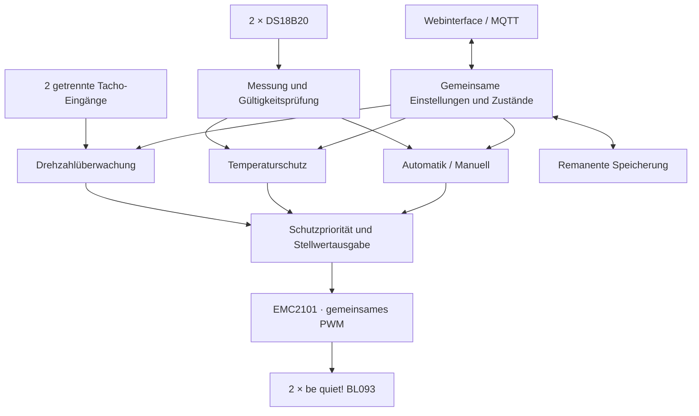
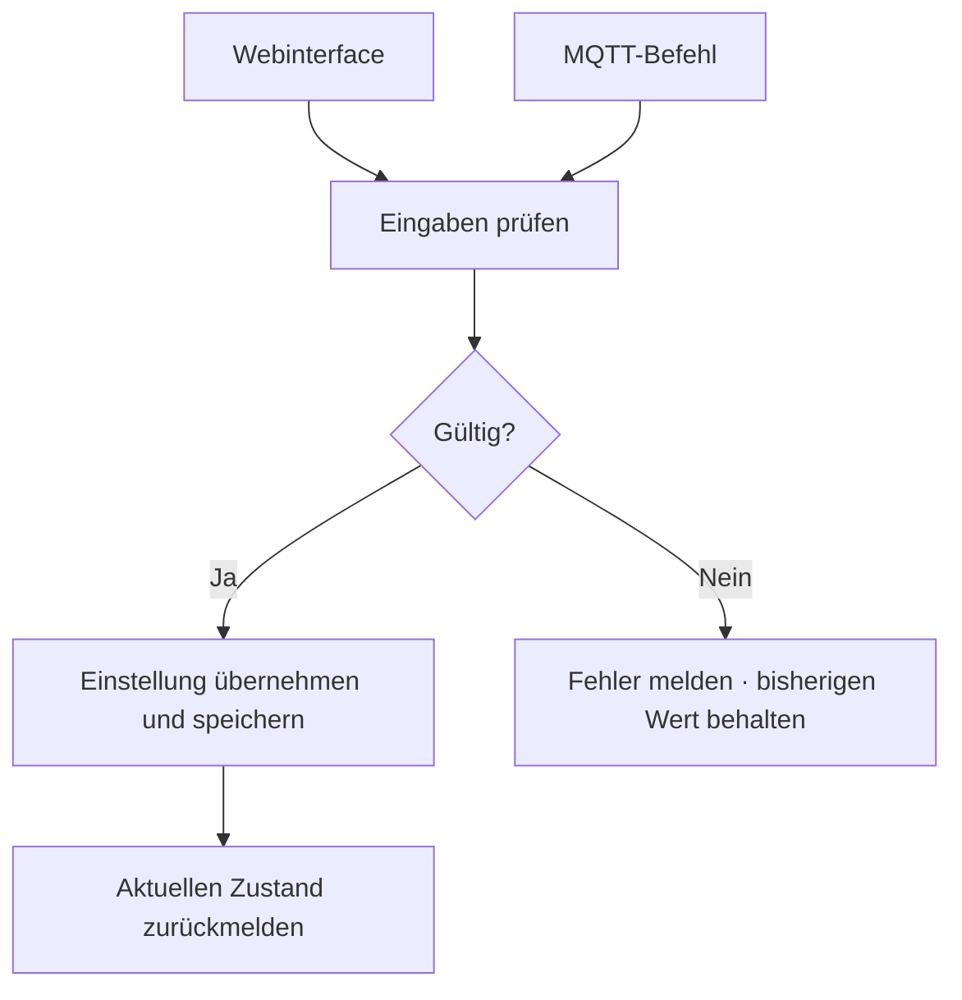
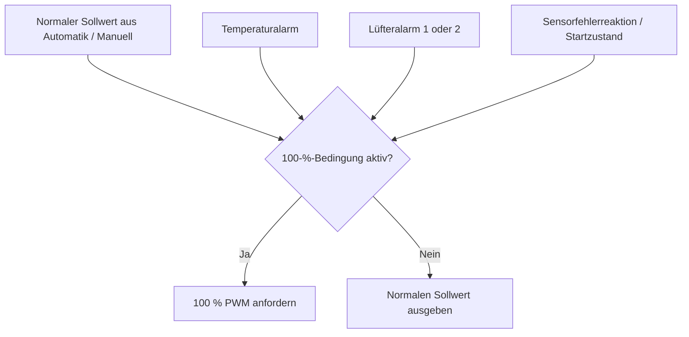
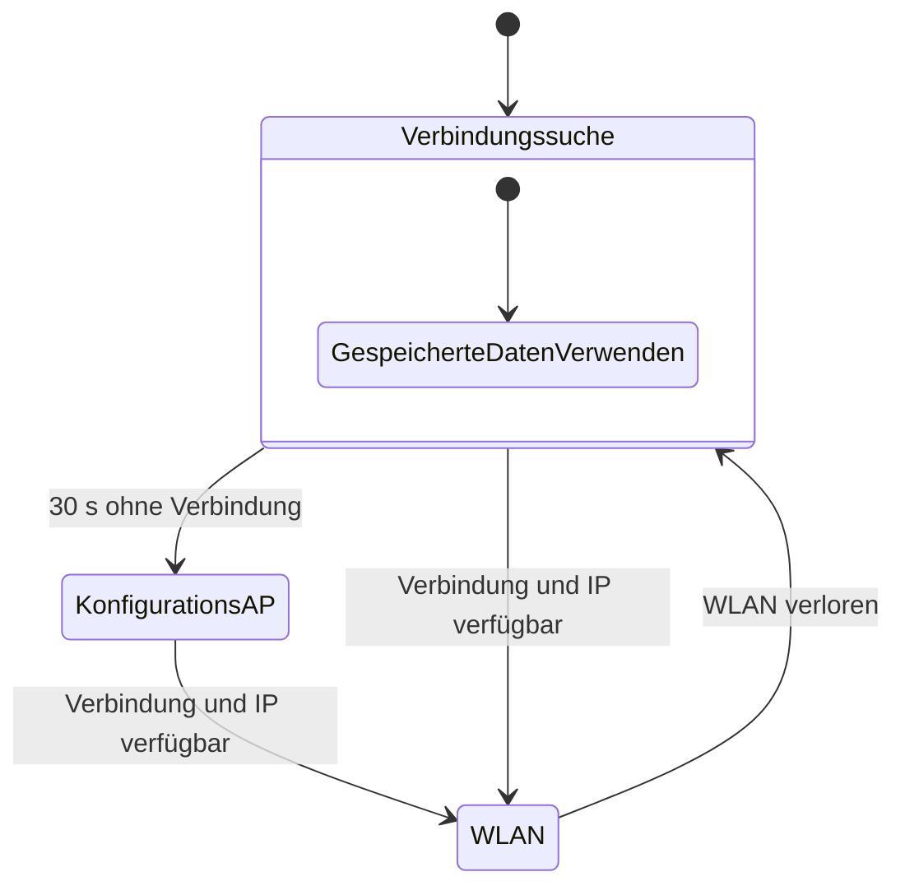

# VENTIQ — Software

> **Smart Cooling System · VENTIQ Core RevA**  
> **Stand:** 23. Oktober 2026 · **Phase:** Softwarekonzept / Entwicklungsplanung  
> **Firmware:** Eigenes Arduino-Programm für Wemos D1 mini / ESP8266  
> **Status:** Funktionsumfang festgelegt; Standardwerte und Hardwareparameter teilweise offen

---

## 1. Projekt auf einen Blick

Die VENTIQ-Firmware regelt zwei Racklüfter lokal anhand von Temperaturen. Beide Lüfter erhalten denselben PWM-Stellwert; ihre Drehzahlen werden einzeln überwacht. WLAN, Webinterface und MQTT ermöglichen Einrichtung, Anzeige und Fernbedienung. Die Kühlregelung benötigt weder Internet noch ioBroker.

| 🧠 Plattform | 🌡️ Erfassung | 🌬️ Regelung | 📡 Vernetzung |
|:--|:--|:--|:--|
| Wemos D1 mini · ESP8266 · Arduino | 2 × DS18B20 · jede Sekunde | EMC2101 · gemeinsames PWM · separate RPM | WLAN mit Konfigurations-AP · Webinterface · MQTT |

### Zielarchitektur

> **Wichtig:** Die Grafik zeigt die Softwarefunktionen. Vorerst ist **kein zusätzlicher Hardware-Fail-safe** vorgesehen. Ein Softwarebefehl für 100 % PWM garantiert bei einem ESP-/EMC2101-Ausfall keine tatsächliche maximale Lüfterleistung.

---

## 2. Entwicklungsfahrplan

**Legende:** ✅ beschlossen · 🧪 am Aufbau abstimmen · 📐 separat ausarbeiten · ⏳ optionale spätere Erweiterung.

Jedes Paket baut auf den vorherigen Paketen auf. Die Abnahmekriterien sind praktische Prüfschritte; sie bedeuten noch keine abgeschlossene Implementierung.

| Paket | Inhalt | Ergebnis |
|---|---|---|
| **01 · Firmwaregrundlage** | Pins, Ablauf, gemeinsame Zustände | Nicht blockierendes Arduino-Grundgerüst |
| **02 · Konfiguration** | Werteprüfung, Standardwerte, Remanenz | Einheitliche und dauerhaft gespeicherte Einstellungen |
| **03 · Temperaturerfassung** | DS18B20, Mittelwert, Sensorfehler | Verlässliche Temperaturbasis |
| **04 · PWM und Betriebsarten** | EMC2101, Kennlinie, Manuell | Lokale Lüftersteuerung |
| **05 · Temperaturschutz** | Warnung, Alarm, Hysteresen | Temperaturbedingte Schutzübersteuerung |
| **06 · Drehzahlüberwachung** | RPM, Plausibilität, Alarmrückkehr | Separate Lüfterüberwachung |
| **07 · WLAN und AP** | Verbindung, Wiederverbindung, Hotspot | Lokaler Netzwerkzugang |
| **08 · Webinterface** | Istwerte, Einstellungen, WLAN-Einrichtung | Bedienung im Browser |
| **09 · MQTT** | Daten senden, Befehle empfangen | Bidirektionale ioBroker-Anbindung |
| **10 · Gesamtabnahme** | Neustarts, Fehlerfälle, Hardwareabstimmung | Geprüfter erster Funktionsstand |
| **11 · OTA** | Firmwareupdates über WLAN | 🔧 Basis ab Paket 01 vorgesehen; lokaler Upload implementiert, GitHub-Update später |

---

## 3. Feature-Paket 01 — Firmwaregrundlage und Schnittstellen

### Festgelegte Plattform

- **Eigenes Arduino-Programm**, keine ESPHome-Firmware.
- Wemos D1 mini mit ESP8266; kein ESP32 vorgesehen.
- Temperaturmessung, Regelung und Schutzfunktionen laufen lokal.
- WLAN-Verbindungsaufbau, Wiederholungen und MQTT dürfen die Regelung nicht blockieren.

### Pinbelegung

| Funktion | Wemos-Pin | GPIO | Verbindung |
|---|---|---:|---|
| I²C SCL | **D1** | 5 | EMC2101 SCL |
| I²C SDA | **D2** | 4 | EMC2101 SDA |
| Tacho Lüfter 1 | **D5** | 14 | Separates Tachosignal Lüfter 1 |
| Tacho Lüfter 2 | **D6** | 12 | Separates Tachosignal Lüfter 2 |
| 1-Wire DATA | **D7** | 13 | Beide DS18B20 gemeinsam |
| Versorgung | **5V** | — | Pololu-5-V-Ausgang |
| Sensorversorgung | **3V3** | — | DS18B20 VDD |
| Masse | **GND** | — | Gemeinsame Bezugsmasse |

PWM kommt vom EMC2101 und benötigt keinen eigenen ESP-Ausgang. Beide Tachosignale bleiben getrennt; Pull-ups und elektrische Beschaltung stehen im Hardwareplan. In der Firmware GPIO-Nummern eindeutig verwenden.

### Abnahme

- [ ] Board startet zuverlässig mit angeschlossener Peripherie.
- [ ] I²C-, Temperatur- und Tacho-Schnittstellen lassen sich getrennt diagnostizieren.
- [ ] Ablauf bleibt auch ohne Netzwerk reaktionsfähig.

---

## 4. Feature-Paket 02 — Konfiguration und Remanenz

**Sämtliche Einstellungen werden dauerhaft gespeichert**, unabhängig davon, ob sie über Webinterface oder MQTT geändert wurden. Das umfasst auch Betriebsart und manuelle Prozentvorgabe.

| Situation | Festgelegtes Verhalten |
|---|---|
| Gültige Änderung | Übernehmen und remanent speichern |
| Ungültige Änderung | Ablehnen, bisherigen gültigen Wert behalten, Fehler zurückmelden |
| Neustart | Gespeicherte Einstellungen wiederherstellen; Start- und Schutzverhalten beachten |
| Konfiguration fehlt oder ist beschädigt | Definierte Standardwerte laden; bis zur gültigen Regelkonfiguration 100 % PWM anfordern |

Laufende Messwerte und Alarmzustände sind keine Einstellungen. Einstellungen nur bei Änderungen speichern, nicht bei jedem Messzyklus.

### Gemeinsamer Konfigurationsweg

### Abnahme

- [ ] Einstellungen überstehen Neustart und Spannungsverlust nach abgeschlossener Speicherung.
- [ ] Unzulässige Kennlinien-/Alarmwerte werden abgelehnt.
- [ ] Fehlende oder beschädigte Konfiguration führt zum festgelegten Startverhalten.
- [ ] Standardwerte für die erste Inbetriebnahme sind vor Implementierung konkret festgelegt. 📐

---

## 5. Feature-Paket 03 — Temperaturerfassung und Sensorprüfung

### Erfassung

| Funktion | Festlegung |
|---|---|
| Sensor 1 | **Oben**, warme Abluft |
| Sensor 2 | **Unten**, Zuluft / Referenz |
| Bus | Gemeinsam an D7/GPIO13; eigene Versorgung über VDD |
| Zuordnung | Feste Sensoradressen, keine Zuordnung nach Erkennungsreihenfolge |
| Messintervall | **Beide Sensoren jede Sekunde** |
| Mittelwert | Jede Sekunde neu berechnen; arithmetischer Durchschnitt, keine zeitliche Glättung |
| Zusatzwert | Temperaturdifferenz **oben minus unten** |

### Mittelwert und Fehlerreaktion

| Gültige Messwerte | Mittelwertanzeige | Regelverhalten |
|---|---|---|
| Beide gültig | `(Sensor 1 + Sensor 2) / 2` | Gewählte Regelquelle verwenden |
| Nur einer gültig | Verbleibender plausibler Wert | Einstellbar: verbleibenden Sensor verwenden **oder 100 % PWM** |
| Keiner gültig | Ungültig | **Immer 100 % PWM anfordern** |

Die Sensorfehlerreaktion gilt unabhängig von der ursprünglich gewählten Regelquelle. Auch bei gewählter 100-%-Fehlerreaktion bleibt der Mittelwert aus dem einzelnen gültigen Sensor als Anzeige verfügbar. Ein zurückgekehrter Sensor wird nach einer gültigen Messung wieder berücksichtigt.

Fehler separat melden. Ungültige Messungen weder durch 0 °C noch durch alte Ersatzwerte ersetzen. Ein großer Temperaturunterschied allein macht keinen Sensor ungültig.

### Einstellungen

- **Regeltemperatur:** Sensor 1, Sensor 2 oder Mittelwert.
- **Verhalten bei Sensorausfall:** verbleibender plausibler Sensor oder 100 % PWM.

### Abnahme

- [ ] Beide Temperaturen und Mittelwert werden jede Sekunde aktualisiert.
- [ ] Sensoren bleiben nach Neustart richtig zugeordnet.
- [ ] Abziehen und Wiederanschließen jedes Sensors ergibt die festgelegte Reaktion.
- [ ] Ausfall beider Sensoren fordert 100 % PWM an.
- [ ] Plausibilitätsbereich sowie Kriterien für fehlende/veraltete Werte am Aufbau bestimmen. 🧪

---

## 6. Feature-Paket 04 — PWM-Ausgabe, Betriebsarten und Kennlinie

### Betriebsarten

| Betriebsart | Stellwertbildung |
|---|---|
| **Automatik** | Lineare Kennlinie aus gewählter Regeltemperatur |
| **Manuell** | Feste, einstellbare PWM-Prozentvorgabe |

Beide Lüfter erhalten denselben Stellwert. Die Prozentvorgabe bezeichnet **PWM-Tastgrad**, keine garantierte Drehzahl in U/min. Schutzfunktionen haben in beiden Betriebsarten Vorrang.

### Einstellbare Kennlinie

| Einstellung | Bedeutung |
|---|---|
| **Untere Temperatur · T_min** | Unterer Temperaturstützpunkt |
| **Unterer Stellwert · PWM_min** | PWM bei und unter T_min |
| **Obere Temperatur · T_max** | Oberer Temperaturstützpunkt |
| **Oberer Stellwert · PWM_max** | PWM bei und über T_max |

| Temperatur T | Kennliniensollwert |
|---|---|
| `T ≤ T_min` | `PWM_min` |
| `T_min < T < T_max` | `PWM_min + (T − T_min) / (T_max − T_min) × (PWM_max − PWM_min)` |
| `T ≥ T_max` | `PWM_max` |

**Eingabeprüfung:** `T_min < T_max` und `0 % ≤ PWM_min ≤ PWM_max ≤ 100 %`.

### Start und Dynamik

- Beim Einschalten zunächst **100 % PWM anfordern**, bis gültige Temperaturwerte vorliegen. Danach gespeicherte Betriebsart unter Beachtung der Sensorfehlerreaktion und aller Schutzfunktionen übernehmen.
- Bei Bedarf kurzen **Anlaufimpuls** vorsehen; Notwendigkeit, Stellwert und Dauer am Aufbau ermitteln.
- Im Normalbetrieb **langsam herunterregeln**, um hörbare Sprünge zu vermeiden.
- Alarmbedingte 100 % sofort anfordern, ohne die normale Stellwertrampe abzuwarten.
- I²C-/EMC2101-Fehler erkennen und Wiederherstellung versuchen.

### Abnahme

- [ ] Manuelle Prozentvorgabe wirkt auf beide Lüfter.
- [ ] Kennlinie stimmt an beiden Stützpunkten, dazwischen und außerhalb des Bereichs.
- [ ] Alle drei Regelquellen sind auswählbar.
- [ ] Manueller Betrieb und Parameter werden nach Neustart wiederhergestellt; Schutz hat Vorrang.
- [ ] EMC2101 ohne Tacho am Modul, Frequenz, Ausgangspolarität und zwei parallele PWM-Eingänge prüfen. 🧪
- [ ] Zulässigen Stillstand, Mindestleistung, Anlaufimpuls und Absenkgeschwindigkeit am Aufbau bestimmen. 🧪

---

## 7. Feature-Paket 05 — Temperaturwarnung und Temperaturalarm

**Warnung und Alarm überwachen immer den heißeren gültigen Sensor**, unabhängig von der ausgewählten Regeltemperatur. Bei nur einem gültigen Sensor wird dessen Wert verwendet; die Sensorfehlerreaktion bleibt zusätzlich wirksam.

| Einstellung | Funktion |
|---|---|
| **Warnung Max Temp** | Einschaltschwelle der Warnung |
| **Hysterese Warnung** | Abstand zur Rücksetzschwelle |
| **Alarm Max Temp** | Einschaltschwelle des Alarms |
| **Hysterese Alarm** | Abstand zur Rücksetzschwelle |

| Zustand | Verhalten |
|---|---|
| `T ≥ Grenzwert` | Jeweiligen Zustand aktivieren |
| `T < Grenzwert − Hysterese` | Jeweiligen Zustand automatisch zurücksetzen |
| Dazwischen | Bisherigen Zustand beibehalten |
| Temperaturwarnung aktiv | Meldung ausgeben |
| Temperaturalarm aktiv | Meldung ausgeben und **100 % PWM erzwingen** |

Warnung und Alarm werden separat ausgewertet; beide können gleichzeitig aktiv sein. Eingabeprüfung: Warnschwelle kleiner als Alarmschwelle, Hysteresen nicht negativ. Ungültige Temperaturen dürfen einen aktiven Alarm nicht als „abgekühlt“ zurücksetzen.

### Schutzpriorität

Die Übersteuerung endet erst, wenn **keine** aktive Bedingung mehr 100 % verlangt. Eine manuelle Quittierung ist nicht erforderlich.

### Abnahme

- [ ] Heißerer gültiger Sensor bestimmt Warnung und Alarm, auch bei abweichender Regelquelle.
- [ ] Beide Hysteresen funktionieren unabhängig.
- [ ] Temperaturalarm übersteuert auch einen niedrigeren manuellen oder maximalen Kennlinienstellwert.
- [ ] Bei mehreren Fehlern wird 100 % erst nach Wegfall aller entsprechenden Bedingungen freigegeben.

---

## 8. Feature-Paket 06 — Drehzahlmessung und Plausibilitätsalarme

Jeder Lüfter erhält einen eigenen Istwert in **U/min (RPM)** und einen eigenen Plausibilitätsalarm. Unterschiedliche Drehzahlen bei gemeinsamem PWM sind grundsätzlich möglich.

| Funktion | Festlegung |
|---|---|
| Erfassung | Zwei getrennte Tacho-Eingänge |
| Erwartete Drehzahl | PWM-abhängiges Drehzahlband, am realen Aufbau ermitteln |
| Fehler | Zu niedrige/zu hohe Drehzahl oder unerwarteter Stillstand |
| Fehlerverzögerung | **Einstellbar**; Alarm erst bei durchgehend unplausibler Drehzahl über diese Dauer |
| Anlaufzeit | **Einstellbar**; nach Lüfterstart zunächst keine Plausibilitätsprüfung |
| Alarmreaktion | Bereits ein Lüfteralarm erzwingt **100 % PWM für beide Lüfter** |
| Rücksetzung | **Automatisch**, nach stabil plausibler Drehzahl |

Eine plausible Messung setzt eine noch laufende Fehlerverzögerung zurück. Nach Ablauf der Anlaufzeit beginnt die Prüfung einschließlich Fehlerverzögerung. Die Anlaufzeit der Überwachung ist vom tatsächlichen Anlaufimpuls zu unterscheiden.

Nach einem Alarm kontrolliert zur Kennlinie beziehungsweise manuellen Vorgabe zurückkehren. Eine plausible Drehzahl bei 100 % beweist noch nicht, dass die ursprüngliche niedrige Vorgabe zuverlässig funktioniert. Die Rückkehr darf deshalb kein ständiges Pendeln zwischen Alarm und Normalbetrieb verursachen.

### Abnahme

- [ ] Beide Drehzahlen werden unabhängig angezeigt.
- [ ] Impulse pro Umdrehung am konkreten Lüfter verifiziert. 🧪
- [ ] Kurze Messschwankungen lösen innerhalb der Fehlerverzögerung keinen Alarm aus.
- [ ] Anlaufzeit unterdrückt ausschließlich die anfängliche Drehzahlprüfung.
- [ ] Jeder Lüfteralarm erzwingt 100 % für beide Lüfter.
- [ ] Automatische Rückkehr funktioniert ohne manuelle Quittierung und ohne dauerhaftes Pendeln.
- [ ] Messintervall, Drehzahlbänder, Zeitwerte und Rückkehrverfahren am Aufbau abstimmen. 🧪

> **Noch nicht bestätigt:** Ein zusätzlicher frei einstellbarer Drehzahltoleranzwert. Das erwartete Band selbst wird am Aufbau ermittelt.

---

## 9. Feature-Paket 07 — WLAN und Konfigurations-Hotspot

### Hotspot-Konfiguration

| Parameter | Festlegung |
|---|---|
| **SSID** | `VENTIQ-Config` |
| **Passwort** | `VENTIQ-Setup` · Groß-/Kleinschreibung beachten |
| **AP-IP** | `192.168.0.1` |
| **Aktivierungsverzögerung** | **30 Sekunden ohne WLAN-Verbindung** |

### Verbindungsverhalten

- Beim Neustart mit gespeicherten WLAN-Daten verbinden.
- Ohne Verbindung nach 30 Sekunden den AP öffnen; das gilt auch für fehlende Konfiguration und spätere WLAN-Ausfälle.
- Während AP-Betrieb im Hintergrund weiter versuchen, das gespeicherte WLAN zu erreichen.
- Sobald WLAN und nutzbare IP-Konfiguration verfügbar sind, AP abschalten.
- Webinterface anschließend über die WLAN-IP erreichen.
- Reiner MQTT-/ioBroker-/Internetausfall öffnet keinen AP, solange WLAN verbunden ist.
- Kühlregelung läuft während aller Verbindungszustände weiter.

### Netzwerkeinstellungen im Webinterface

| Einstellung | Inhalt |
|---|---|
| WLAN-SSID / Passwort | Ziel-WLAN |
| IP-Modus | DHCP oder statische IPv4-Konfiguration |
| Statische IPv4-Adresse | Geräteadresse |
| Subnetzmaske | Netzmaske |
| Gateway | Routeradresse |
| DNS-Server | Namensauflösung |

### Abnahme

- [ ] Ersteinrichtung über AP möglich.
- [ ] Gespeicherte WLAN-/IP-Einstellungen werden beim Neustart genutzt.
- [ ] Fehlverbindung und späterer Verbindungsverlust aktivieren nach 30 s den AP.
- [ ] Wiederverbindung schaltet den AP aus.
- [ ] DHCP und statische IP funktionieren.
- [ ] Überlappung von AP-Subnetz und Ziel-WLAN bei Implementierung prüfen.

**Noch nicht vorgesehen:** ein ausdrücklich festgelegtes Captive Portal. Der Browserzugriff über die AP-IP gehört zum Umfang.

---

## 10. Feature-Paket 08 — Lokales Webinterface

| Bereich | Geplanter Inhalt |
|---|---|
| **Übersicht** | Temperaturen, Mittelwert, Drehzahlen, PWM, Betriebsart, Verbindungsstatus und Alarme |
| **Einstellungen** | Regelung, Schutzparameter, WLAN/IP und MQTT |

- **Kein Zugriffsschutz des Webinterfaces** vorgesehen.
- Das WLAN-Passwort des Konfigurations-AP bleibt davon unabhängig.
- Webinterface im AP-Betrieb und bei bestehender WLAN-Verbindung bereitstellen.
- Eingaben über den gemeinsamen Konfigurationsweg prüfen und remanent speichern.
- Bei Schutzübersteuerung tatsächlichen Stellwert und Ursache anzeigen.
- Detaillierte Seitenstruktur und Gestaltung werden später separat geplant. 📐

### Abnahme

- [ ] Istwerte und Fehlerzustände sind eindeutig erkennbar.
- [ ] Alle freigegebenen Einstellungen sind änderbar und bleiben nach Neustart erhalten.
- [ ] Ungültige Eingaben werden mit verständlicher Rückmeldung abgelehnt.
- [ ] WLAN-Ersteinrichtung und spätere Änderung der Zugangsdaten sind möglich.

---

## 11. Feature-Paket 09 — MQTT und ioBroker

MQTT ist **bidirektional**: Der Controller veröffentlicht Messwerte und Zustände und empfängt Sollwerte, Betriebsart sowie weitere freigegebene Einstellungen.

### Broker-Einstellungen

Vorgesehene Felder: Broker-Host/IP, Port, Benutzername, Passwort und Topic-Präfix. Exakte Vorgaben, Client-ID und TLS-Entscheidung werden bei der Schnittstellenplanung festgelegt. 📐

### Zu übertragende Informationen

| Bereich | Inhalt |
|---|---|
| Temperaturen | Sensor 1, Sensor 2, Mittelwert, Differenz, Gültigkeit |
| Regelung | Regelquelle, wirksame Regeltemperatur, Kennliniensollwert, tatsächlich angeforderter PWM-Stellwert, Übersteuerungsgrund |
| Lüfter | RPM und Plausibilitätsalarm je Lüfter |
| Schutz | Temperaturwarnung/-alarm, Sensorfehler, I²C-/EMC2101-Fehler, Sammelalarm |
| Gerät | Verfügbarkeit, Betriebszustand, Firmwareversion, Laufzeit |
| Netzwerk | WLAN-IP und Signalstärke |
| Einstellungen | Aktive freigegebene Parameter, ohne Passwörter |

**Die exakten Datenpunkte, Topics und Nachrichtenformate werden im Verlauf festgelegt.** Ebenfalls noch auszuarbeiten: QoS, Retain-Verhalten, Last Will und Veröffentlichungsintervalle. Vorschlag zur Ausarbeitung: Messwerte jede Sekunde, Alarmänderungen unmittelbar, Diagnosedaten seltener.

### Befehle und Persistenz

- Per MQTT geänderte Einstellungen werden **genauso persistent** gespeichert wie Webänderungen.
- Beide Bedienwege greifen auf denselben Zustand und dieselbe Eingabeprüfung zu.
- Akzeptierte Einstellungen, wirksamen Stellwert und Schutzübersteuerung unterscheidbar zurückmelden.
- Befehls- und Zustandstopics trennen.
- Keine veralteten Befehle nach Neustart oder Wiederverbindung ungeprüft ausführen. Dies verhindert nicht das bewusste Wiederherstellen gespeicherter Einstellungen.
- Schutzfunktionen lassen sich durch MQTT nicht umgehen.

### Verbindungsausfall

Bei Broker-Ausfall lokal weiterregeln und automatisch erneut verbinden. Im manuellen Betrieb bleiben Betriebsart und feste Prozentvorgabe bestehen. Nach Wiederverbindung den aktuellen vollständigen Zustand veröffentlichen. Ungültige Sensorwerte nicht als 0 übertragen und alte Brokerwerte nicht als aktuelle Messungen darstellen.

### Abnahme

- [ ] Daten sind in ioBroker auswertbar.
- [ ] Betriebsart und Sollwerte lassen sich über MQTT ändern.
- [ ] MQTT-Änderungen sind im Webinterface sichtbar und nach Neustart erhalten.
- [ ] Fehlerhafte Befehle werden abgelehnt und zurückgemeldet.
- [ ] Broker-Ausfall unterbricht weder Regelung noch Schutzfunktionen.
- [ ] Wiederverbindung führt nicht zur ungeprüften Ausführung alter Befehle.

---

## 12. Feature-Paket 10 — Gesamtabnahme und Hardwareabstimmung

### Fehler- und Neustartprüfung

| Prüffall | Erwartetes Ergebnis |
|---|---|
| Neustart | Startanforderung 100 %, danach gespeicherte Betriebsart mit Schutzpriorität |
| Ein Sensor fehlt | Gewählte Sensorfehlerreaktion; Fehler separat sichtbar |
| Beide Sensoren fehlen | Ungültige Regeltemperatur und 100 % PWM-Anforderung |
| Temperaturalarm | Beide Lüfter 100 %, automatische Rücksetzung über Hysterese |
| Ein Lüfter unplausibel | Nach Prüfzeiten eigener Alarm und beide Lüfter 100 % |
| Alarmursache entfällt | Automatische Rücksetzung; weitere aktive Schutzbedingungen bleiben wirksam |
| WLAN fällt aus | Regelung weiter; nach 30 s Konfigurations-AP |
| MQTT fällt aus | Lokaler Betrieb bleibt erhalten; automatische Wiederverbindung |
| Ungültige Einstellung | Ablehnung, bisheriger Wert bleibt |
| Konfiguration beschädigt | Standardwerte und 100 % bis gültige Regelkonfiguration |
| I²C-/EMC2101-Fehler | Fehler erkennen und Wiederherstellung versuchen; tatsächliches Ausgangsverhalten prüfen |

### Am Aufbau festzulegen 🧪

- [ ] Zulässiger Lüfterstillstand und zuverlässige Mindestleistung.
- [ ] Anlaufimpuls sowie Absenkgeschwindigkeit.
- [ ] PWM-Frequenz und elektrische Kompatibilität beider Lüfter.
- [ ] Tacho-Impulse pro Umdrehung, Messintervall und erwartete Drehzahlbänder.
- [ ] Fehlerverzögerung, Anlaufzeit und stabile automatische Alarmrückkehr.
- [ ] Temperatur-Plausibilitätsgrenzen und Ausfall-/Aktualitätskriterien.
- [ ] Geeignete Temperaturkennlinie sowie Warn-/Alarmwerte.

> **Hardware-Fail-safe:** Vorerst keiner. Verhalten bei ESP-Absturz, Reset und PWM-Controller-Ausfall messen und dokumentieren; ohne zusätzliche Maßnahmen besteht keine zugesicherte sichere Lüfterreaktion.

---

## 13. Feature-Paket 11 — OTA-Firmwareupdates 🔧

**Entscheidung:** OTA-fähige Architektur von Anfang an. Der lokale Web-Upload gehört zur ersten nutzbaren Firmware; das GitHub-Release-Update bleibt eine spätere Erweiterung. Die Kühlregelung darf nie von Updatefunktionen abhängen.

Festgelegt und umgesetzt (Details in [Firmware/docs/OTA.md](../Firmware/docs/OTA.md)):

- Flash-Layout `4m1m` (4 MB, 1 MB LittleFS); Konfiguration im Dateisystem bleibt beim Update erhalten.
- Lokaler `.bin`-Upload per HTTP (`POST /api/update`), als Stream ohne Image im RAM; genau ein Update gleichzeitig.
- **SHA-256 ist Pflicht**; zusätzlich muss das Image eine VENTIQ-Kennung (Hardwareziel `VENTIQ_CORE_REVA` und Version) genau einmal enthalten.
- **Downgrades sind gesperrt**, auch nicht per Bestätigung; gleiche Version ist erlaubt.
- Zentrale Firmwareidentität (Version, Hardwareziel) in `FirmwareInfo`.
- Update-Kern (`UpdateManager`) mit Zustandsmodell, getrennt vom Web-Transport.
- Schnittstelle `ICoolingGuard`: Das Update fordert vor dem Start einen konservativen Kühlzustand an und kann bei einem Schutzfehler abgelehnt werden. Bis zu den Paketen 04/05 nur ein Platzhalter.

**Bewusst offen / Einschränkungen:**

- **Keine Authentifizierung** am Upload-Endpunkt (Produktentscheidung). Jeder mit Netzwerkzugang kann ein gültig formatiertes Image einspielen.
- **Keine Signatur:** SHA-256 und Kennung schützen vor Fehlern, nicht vor absichtlich gebauten Images. Ein Herkunftsnachweis (z. B. Ed25519) ist nicht entschieden.
- **Kein Rollback / keine Dual-Bank:** Ein Stromausfall während der Bootloader-Kopie kann das Gerät unbrauchbar machen; Wiederherstellung per USB.
- Verhalten von EMC2101 und Lüftern bei Update, ESP-Reset und I²C-Ausfall ist nicht gemessen; es besteht keine Fail-safe-Zusage.
- Prüfung der realen Flashgröße zur Laufzeit und echter Upload auf Hardware stehen aus.
- GitHub-Release-Update (Manifest, HTTPS, Versionsfilter, Nutzerbestätigung) ist noch nicht umgesetzt.

---

## 14. Einstellungsübersicht für die Entwicklung

Alle tatsächlich angebotenen Einstellungen sind remanent zu speichern.

| Gruppe | Festgelegte Einstellungen |
|---|---|
| Betriebsart | Automatik / Manuell |
| Manuell | Feste PWM-Prozentvorgabe |
| Temperaturquelle | Sensor 1 / Sensor 2 / Mittelwert |
| Sensorfehler | Verbleibenden Sensor nutzen / 100 % PWM |
| Kennlinie | Untere Temperatur, unterer Stellwert, obere Temperatur, oberer Stellwert |
| Temperaturschutz | Warnschwelle, Warnhysterese, Alarmschwelle, Alarmhysterese |
| Lüfterüberwachung | Fehlerverzögerung, Anlaufzeit |
| WLAN | SSID, Passwort |
| IP | DHCP/statisch, Adresse, Subnetzmaske, Gateway, DNS |
| MQTT | Brokerparameter im Paket 09 konkretisieren |

Weitere technische Parameter wie Stabilitätsdauer der Alarmrücksetzung, Plausibilitätsgrenzen, Absenkgeschwindigkeit und Anlaufimpuls werden bei der Hardwareabstimmung bestimmt. Welche davon zusätzliche Webfelder erhalten, ist noch separat festzulegen.

### Verbleibende Konzeptarbeit 📐

1. Standardwerte für die erste Inbetriebnahme bestimmen.
2. MQTT-Datenpunkte, Befehle und Übertragungsverhalten konkretisieren.
3. Webinterface separat gestalten.
4. Hardwareparameter messen und automatische Lüfteralarm-Rückkehr technisch ausarbeiten.

---

## 15. Abgrenzung zu den anderen Projektteilen

| Teil | Inhalt |
|---|---|
| **1 · Hardware** | Module, Versorgung, Verbindungen, Komponenten und elektrische Anforderungen |
| **2 · Software (dieses Dokument)** | Firmware, Automatik, Schutzfunktionen, WLAN, Webinterface, MQTT und Entwicklungsreihenfolge |
| **3 · Platine / Gehäuse** | Fusion 360 Electronics, Schaltplan, Footprints, Layout und mechanischer Aufbau |

**Leitgedanke:** Lokal zuverlässig regeln, Zustände nachvollziehbar anzeigen und die Entwicklung in einzeln prüfbaren Schritten aufbauen.
