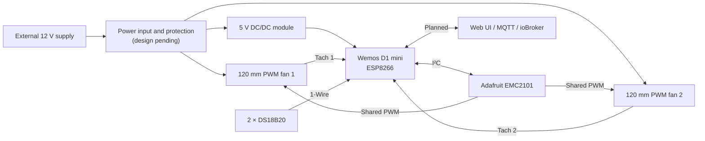

  

<h1 align="center">VENTIQ</h1>

<strong>Smart Cooling System — Intelligent Airflow Control</strong>

  
  
  
  
  

VENTIQ is an open-source project to design a quiet, locally controlled cooling system for 19-inch network racks and homelabs. The planned **VENTIQ Core RevA** uses two PWM fans to exhaust warm air from the top of a rack, monitors temperatures at the top and bottom, and measures each fan's RPM independently.

> **Project status:** Concept and requirements defined; hardware validation, PCB design, firmware implementation, and system testing are still to come. VENTIQ is not yet a finished or tested controller.

## At a glance

| | RevA concept |
|---|---|
| Controller | Wemos D1 mini with ESP8266 |
| Cooling | 2 × be quiet! Silent Wings 4 PWM, 120 mm, BL093 |
| Fan control | One shared PWM command; separate tachometer inputs |
| Temperature | 2 × DS18B20 on a shared 1-Wire bus |
| PWM controller | Adafruit EMC2101 breakout (ADA4808), controlled over I²C |
| Firmware | Custom Arduino firmware (planned) |
| Connectivity | Local web interface, Wi-Fi setup access point, MQTT / ioBroker (planned) |
| Power | External 12 V supply; Pololu S13V20F5 module for 5 V |

The controller is intended to keep regulating locally if Wi-Fi, the MQTT broker, or ioBroker is unavailable. No cloud service is required for the cooling function.

## Planned features

The features below are **specified in the project concept, not implemented or verified yet**.

- **Temperature monitoring:** Read two DS18B20 sensors every second. Use the top sensor, bottom sensor, or their average as the control temperature.
- **Automatic and manual operation:** Apply a configurable linear temperature-to-PWM curve, or set a fixed PWM duty cycle manually.
- **Independent fan monitoring:** Report each fan's RPM separately and detect implausible speed or unexpected stoppage.
- **Protective overrides:** Temperature alarms, sensor-failure behavior, startup, and fan alarms can request 100% PWM. A fan alarm is intended to request full output for both fans.
- **Local configuration:** Provide a browser-based interface and a Wi-Fi configuration access point if the configured network is unavailable.
- **MQTT integration:** Publish status and measurements and accept validated configuration commands for ioBroker integration.
- **Persistent settings:** Use one validated configuration path for both web and MQTT changes and restore settings after restart.
- **Network-independent cooling:** Keep the local control loop running when Wi-Fi, MQTT, or ioBroker is unavailable.

Some operating values—including initial defaults, temperature thresholds, fan startup behavior, and RPM limits—remain to be established during testing with the selected hardware.

## System concept

This is a functional overview, **not a released schematic**. Electrical details, component footprints, protection, and behavior during controller faults still need validation.

## Hardware selected for the concept

| Part | Selection | Status |
|---|---|---|
| Microcontroller | Wemos D1 mini (ESP8266) | Existing board; pin assignment still needs validation |
| PWM controller | Adafruit EMC2101 breakout, ADA4808 | Selected; manual PWM mode and output compatibility need testing |
| Fans | 2 × be quiet! Silent Wings 4 PWM, BL093 | Selected; rack mounting and airflow need checking |
| 5 V regulator | Pololu S13V20F5, 5 V / 2 A | Selected; PCB integration and power budget need verification |
| External supply | Mean Well GST36E12-P1J, 12 V / 3 A | Selected |
| PCB power jack | DCK21-P1, 5.5 × 2.1 mm, right-angle THT | Selected; contact arrangement and current rating need verification |
| Temperature sensors | 2 × wired DS18B20 probes | Selected; probe wiring and sensor quality need verification |

The proposed fan arrangement is at the top of the rack, exhausting air upwards. The final rack openings, mounting pattern, clearances, and vibration isolation have not yet been confirmed.

## Milestones

Milestones distinguish **planning work completed** from **physical or software implementation**.

### Concept milestones

- [x] Define the VENTIQ Core RevA scope: two fans, two temperature probes, shared PWM, and independent fan RPM monitoring.
- [x] Select the main controller, PWM breakout, fans, regulator, external supply, DC jack, and sensor type.
- [x] Define the software direction: custom Arduino firmware for ESP8266, with local control and planned web/MQTT configuration.
- [x] Document the intended protection behavior, configuration flow, and acceptance tests.
- [x] Record initial PCB and enclosure requirements and identify unresolved design checks.

### Engineering and implementation milestones

- [ ] Validate the EMC2101 PWM mode, signal levels, and control of two fans in parallel.
- [ ] Verify sensor wiring, fan tach signals, GPIO assignment, and ESP8266 boot behavior.
- [ ] Finalize the power input, protection circuit, connector ratings, and controller-fault behavior.
- [ ] Complete rack measurements and finalize fan and controller enclosure mounting.
- [ ] Produce the RevA schematic, component library, and PCB layout.
- [ ] Fabricate and test a prototype.
- [ ] Implement and verify firmware feature packages 01–10.
- [ ] Integrate with ioBroker and complete system-level testing.
- [ ] Evaluate OTA updates as an optional later enhancement.

**No firmware, released PCB, or tested prototype is currently documented as complete.** The checked milestones above refer to decisions and documentation, not working hardware or software.

## Important limitations and open questions

- A software request for 100% PWM does **not** guarantee full fan speed during a Wemos reset/crash or EMC2101 failure. No hardware fail-safe is currently designed or validated.
- The EMC2101's manual PWM behavior without its own tach input, its output pull-up/level, and parallel fan compatibility must be tested before PCB release.
- The selected DC jack's switched contacts, footprint, polarity, and current rating must be confirmed. The supply rating alone does not establish that the jack, PCB traces, or connectors can safely carry that current.
- Fan openings and mounting dimensions on the rack lid have not been measured.
- The web interface is currently specified without access control. Treat it as a local interface for a trusted network unless that design decision changes.
- MQTT topics, payloads, QoS, retained-message behavior, and Last Will configuration remain to be defined.

## Documentation

- [Hardware concept and component details](Concept/Hardware_DE.md)
- [Software requirements and development plan](Concept/Software_DE.md)
- [Project overview and current decisions](Concept/Plan.md)
- [PCB and casing task list](Concept/PCB_and_Casing.md)

The detailed concept documents are currently maintained in German.

## Development approach

VENTIQ is being developed in stages: validate the selected hardware and rack fit first, complete the electrical design and PCB, test a prototype, then implement and verify the firmware and ioBroker integration. Design assumptions should be measured or checked against component documentation before they become PCB requirements.

## Project goals

- Quiet, temperature-based rack cooling
- Local operation without cloud or home-automation dependencies
- Independently observable fans and sensors
- Modular, repairable hardware using readily available modules
- Clear documentation of decisions, test results, and limitations
